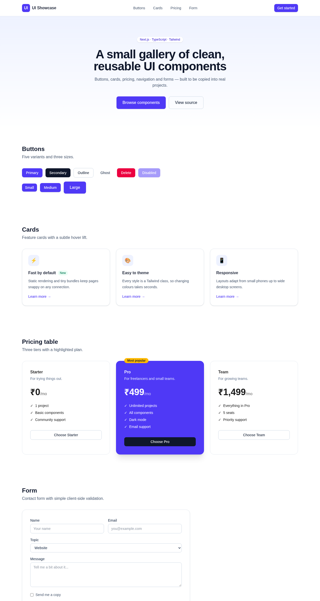

# UI Showcase

A small gallery of clean, reusable UI components I built with **Next.js**, **TypeScript** and **Tailwind CSS**. I made it as a place to keep the pieces I end up rebuilding on almost every website — so next time I can just copy them.



## What's inside

| Component | File | Notes |
|---|---|---|
| Button | `components/Button.tsx` | 5 variants (primary, secondary, outline, ghost, danger), 3 sizes, disabled + focus states |
| Card | `components/Card.tsx` | Feature card with icon, optional tag and hover lift |
| Pricing table | `components/Pricing.tsx` | Three tiers with a highlighted "most popular" plan |
| Navbar | `components/Navbar.tsx` | Sticky, blurred background, mobile menu toggle |
| Form | `components/ContactForm.tsx` | Contact form with simple client-side email validation |

## Run it locally

```bash
npm install
npm run dev
```

Then open http://localhost:3000.

To make a production build:

```bash
npm run build
npm start
```

## Tech

- Next.js 15 (App Router)
- TypeScript
- Tailwind CSS v4

## Using a component

Every component is a single file with no extra dependencies. Copy it into your own `components/` folder and use it:

```tsx
import { Button } from "@/components/Button";

<Button variant="outline" size="lg">Click me</Button>
```

## Author

**Navpreet Singh** — web developer from Amritsar, India.
GitHub: [@navpreet-dev](https://github.com/navpreet-dev)
